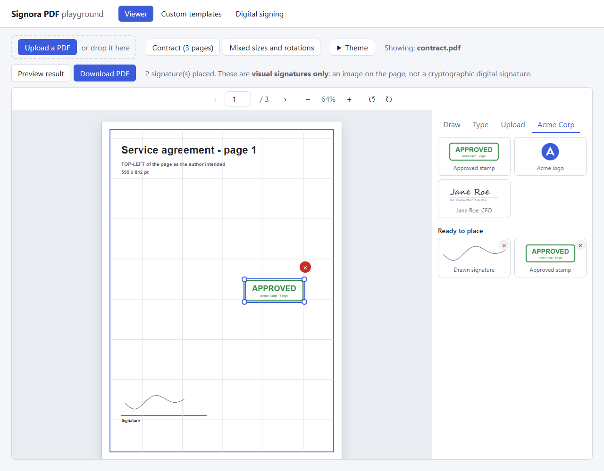
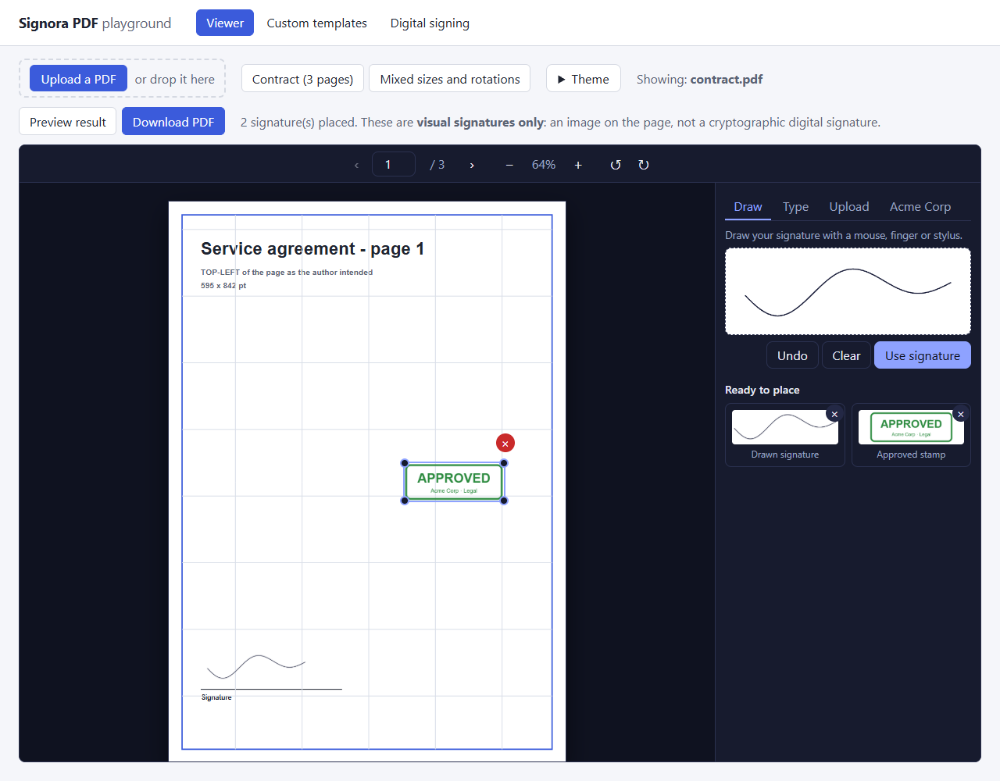
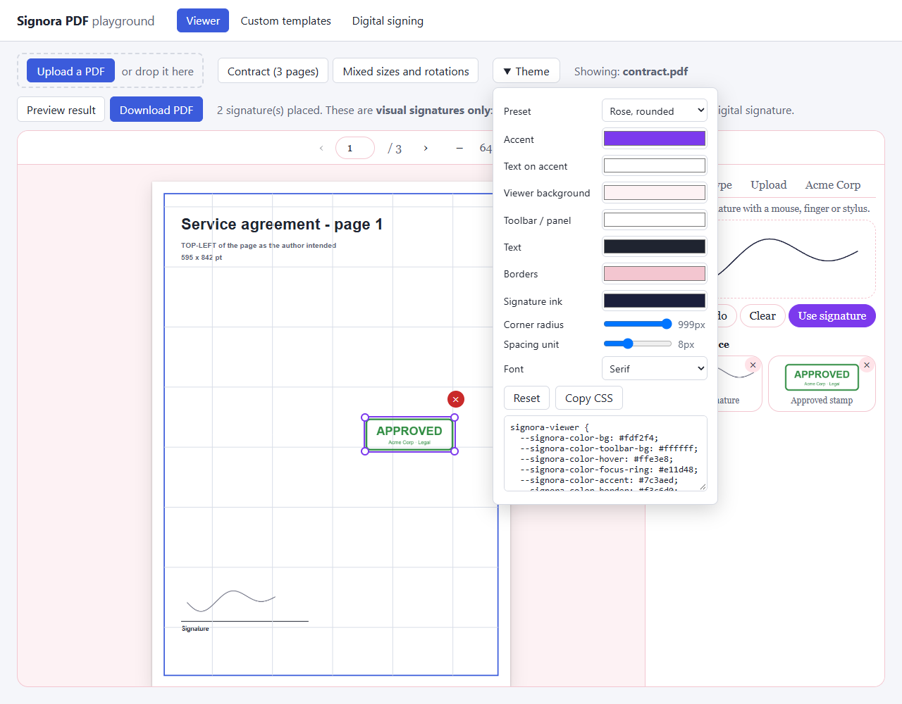
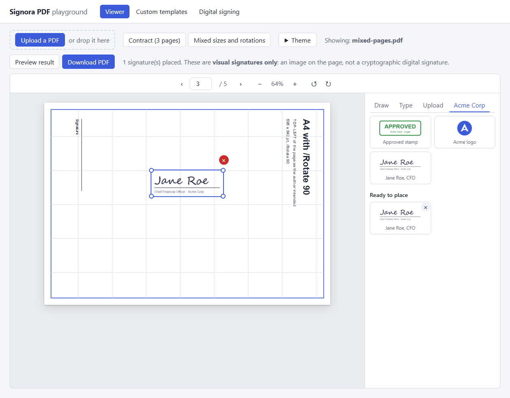
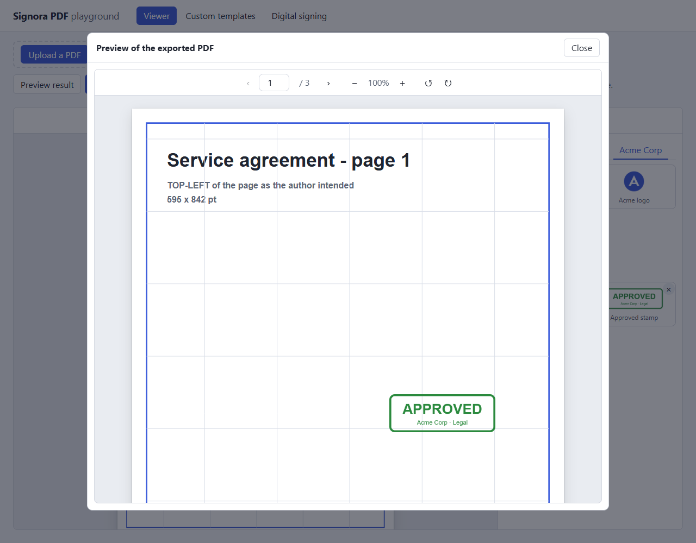
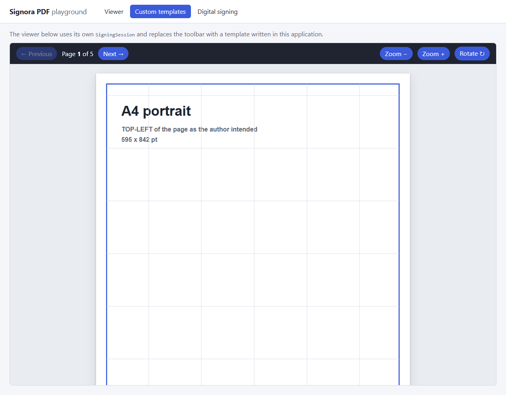
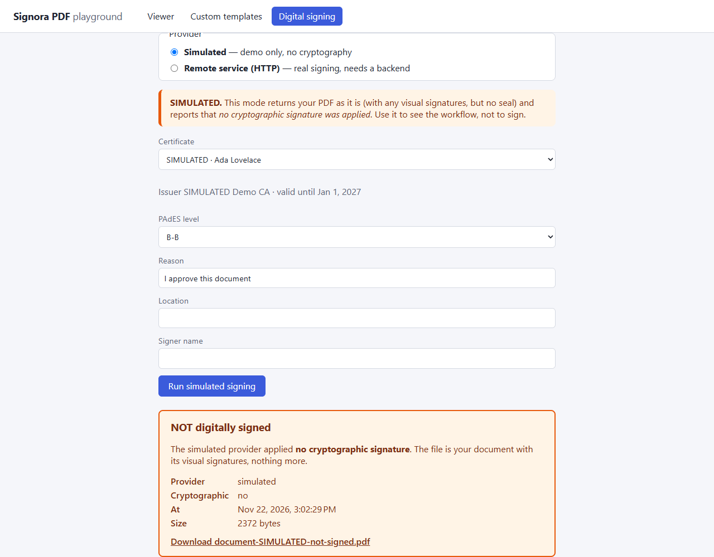

# Signora PDF

> A modular, extensible and themeable Angular SDK for viewing and signing PDF documents.

[](https://github.com/oscarandrespabonestrella/signora-pdf/actions/workflows/ci.yml)
[](LICENSE)

**Status: `0.1.0-alpha`.** The architecture, the public API of the core and the viewer are in
place, you can create and place visual signatures, export the result as a new PDF, and hand it
to a signing backend for a digital signature ([docs](docs/digital-signing.md)). The library does
not ship a backend or any cryptography. The API may change before `1.0`.



<table>
  <tr>
    <td width="50%"><br><sub><b>Theming</b> with CSS variables: a dark preset.</sub></td>
    <td width="50%"><br><sub><b>Live theme editor</b> that generates the CSS to paste.</sub></td>
  </tr>
  <tr>
    <td><br><sub>Pages with their own <code>/Rotate</code>: placements stay put and upright.</sub></td>
    <td><br><sub>Export and preview of the real result.</sub></td>
  </tr>
  <tr>
    <td><br><sub>Replace any section with your own template.</sub></td>
    <td><br><sub>Digital signing through a provider; the simulated one says it is <b>not</b> signed.</sub></td>
  </tr>
</table>

## What works today

| Area                                                                              | State                               |
| --------------------------------------------------------------------------------- | ----------------------------------- |
| PDF viewer (PDF.js): load from URL, Blob, ArrayBuffer                             | ✅                                  |
| Page navigation, zoom, rotation, keyboard shortcuts                               | ✅                                  |
| Normalized coordinate model (zoom, rotation, `/Rotate`, CropBox)                  | ✅                                  |
| Headless `SigningSession` (signals) + ports for every engine                      | ✅                                  |
| Theming with `--signora-*` design tokens, template slots                          | ✅                                  |
| Signature creation: draw (mouse, touch, stylus), type, upload, organization       | ✅                                  |
| Drag, resize, keyboard and drag-and-drop placement; multiple signatures and pages | ✅                                  |
| Visual export with pdf-lib (`session.exportPdf()`), CropBox and `/Rotate` aware   | ✅                                  |
| Digital signing through your backend (HTTP provider, PAdES levels as metadata)    | ✅ client side; the server is yours |

## Design in one minute

The SDK is split in entry points so that dependencies are enforced by packaging, not discipline:

| Entry point           | Contains                                                      | Depends on         |
| --------------------- | ------------------------------------------------------------- | ------------------ |
| `signora-pdf`         | models, ports (interfaces), coordinates, `SigningSession`, DI | Angular only       |
| `signora-pdf/pdfjs`   | PDF.js implementation of the rendering port                   | `pdfjs-dist`       |
| `signora-pdf/pdf-lib` | pdf-lib implementation of the writer port                     | `pdf-lib`          |
| `signora-pdf/ui`      | viewer, page, toolbar, template slots, theme directive        | core               |
| `signora-pdf/http`    | HTTP digital signature and certificate providers              | core, `HttpClient` |

`pdfjs-dist` and `pdf-lib` are **optional peer dependencies**: install only what you use, or
implement the ports with another engine. Cryptographic signing is deliberately separate from
visual signing, and the library never implements cryptography itself.
Read [docs/architecture.md](docs/architecture.md) for details.

## Installation

```bash
npm install signora-pdf pdfjs-dist
# for visual export:
npm install pdf-lib
```

Requires Angular 22+.

Serve the PDF.js worker from your app, for example with an asset glob in `angular.json`:

```json
{
  "glob": "pdf.worker.min.mjs",
  "input": "node_modules/pdfjs-dist/build",
  "output": "assets/pdfjs"
}
```

## Usage

```ts
// app.config.ts
import { provideSignora } from 'signora-pdf';
import { withPdfJsRenderer } from 'signora-pdf/pdfjs';

export const appConfig: ApplicationConfig = {
  providers: [provideSignora(withPdfJsRenderer({ workerSrc: '/assets/pdfjs/pdf.worker.min.mjs' }))],
};
```

```ts
import { Component } from '@angular/core';
import { SignoraViewerComponent } from 'signora-pdf/ui';

@Component({
  imports: [SignoraViewerComponent],
  template: `<signora-viewer [source]="'/files/contract.pdf'" style="height: 80vh" />`,
})
export class ContractPage {}
```

`source` accepts a URL string, `URL`, `Blob`/`File`, `ArrayBuffer` or `Uint8Array`.

### Customize without forking

Theme with CSS variables, on any ancestor or through the directive:

```html
<signora-viewer [signoraTheme]="{ 'color-accent': '#e11d48', radius: '999px' }" />
```

Replace sections with your own templates:

```html
<signora-viewer [source]="url">
  <ng-template signoraSlot="toolbar" let-session>
    <button (click)="session.previousPage()">Back</button>
    {{ session.currentPage() }} / {{ session.pageCount() }}
    <button (click)="session.nextPage()">Next</button>
  </ng-template>
</signora-viewer>
```

See [docs/theming.md](docs/theming.md) for the full token list.

### Options

`viewMode="continuous"` shows all pages in one scroll; `[signatureModes]` turns draw, type,
upload and provider tabs on or off; `[preloadedSignatures]` makes several signatures available
from the start; `(coordinatesChange)` / `session.exportCoordinates()` return just the positions for a
backend that stamps the PDF itself; `[readOnly]` shows signatures without editing. See [docs/viewer-options.md](docs/viewer-options.md).

### Headless

Skip `signora-pdf/ui` and build your own interface on `SigningSession` and the pure functions in
`signora-pdf` (`toViewportRect`, `fromViewportRect`, `toPdfUserSpace`...). Placements are stored
in normalized page coordinates, independent of zoom and rotation; see
[docs/coordinates.md](docs/coordinates.md).

## Documentation

- [Architecture](docs/architecture.md) · [Coordinates](docs/coordinates.md) · [Theming](docs/theming.md) · [Viewer options](docs/viewer-options.md)
  · [Digital signing](docs/digital-signing.md) · [Roadmap](docs/roadmap.md)
- **API reference**, generated from the source with TypeDoc: `npm run docs:api`, then open
  `docs/api/index.html`. CI publishes it as a build artifact.

## Develop

```bash
npm install
npm start               # playground at http://localhost:4200
npm test                # unit tests (Vitest)
npm run lint
npm run build:lib       # builds dist/signora-pdf
npm run docs:api        # generates the API reference in docs/api
npm run screenshots     # recaptures docs/images (needs npm start running and Edge/Chrome)
npm run pack:lib        # builds and creates the npm tarball in dist/
```

The playground consumes the library only through its public API (`signora-pdf/*`).
See [CONTRIBUTING.md](CONTRIBUTING.md).

## License

[MIT](LICENSE)
